<div dir="rtl">

<div align="center">

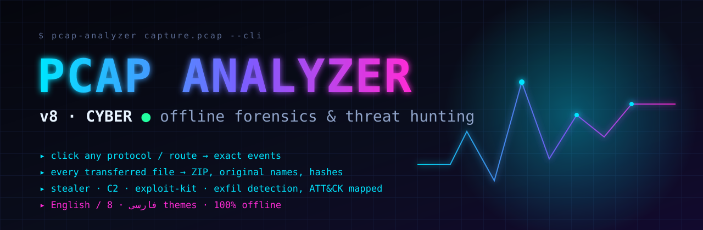

<a href="https://github.com/mr-coder20/pcap-analyzer/releases/latest"></a>
<a href="https://github.com/mr-coder20/pcap-analyzer/releases"></a>
<a href="https://github.com/mr-coder20/pcap-analyzer/stargazers"></a>


### 🛰️ یک PCAP بدهید ← کل ماجرا، حکم نهایی و تک‌تک فایل‌های ردشده از سیم را تحویل بگیرید.

**فارنزیک و شکار تهدید آفلاین · گزارش دارک‌سایبری · جزئیات هر پروتکل با یک کلیک · استخراج دقیق فایل‌ها در ZIP**

🇬🇧 [English](README.md) · 🇮🇷 **فارسی**

<a href="https://github.com/mr-coder20/pcap-analyzer/releases/latest"></a>

</div>

---

## 📡 دانلود (بدون نیاز به پایتون)

| سیستم‌عامل | دانلود |
|---|---|
| 🪟 ویندوز x64 | [`PCAP-Analyzer-windows-x64.exe`](https://github.com/mr-coder20/pcap-analyzer/releases/latest/download/PCAP-Analyzer-windows-x64.exe) |
| 🍎 macOS (Apple Silicon) | [`PCAP-Analyzer-macos-arm64.zip`](https://github.com/mr-coder20/pcap-analyzer/releases/latest/download/PCAP-Analyzer-macos-arm64.zip) |
| 🍎 macOS (اینتل) | [`PCAP-Analyzer-macos-x64.zip`](https://github.com/mr-coder20/pcap-analyzer/releases/latest/download/PCAP-Analyzer-macos-x64.zip) |
| 🐧 لینوکس x64 | [`PCAP-Analyzer-linux-x64.tar.gz`](https://github.com/mr-coder20/pcap-analyzer/releases/latest/download/PCAP-Analyzer-linux-x64.tar.gz) |

➡️ **همه‌ی نسخه‌ها، چک‌سام‌ها و تغییرات:** [https://github.com/mr-coder20/pcap-analyzer/releases/latest](https://github.com/mr-coder20/pcap-analyzer/releases/latest)
یا از سورس: `python pcap_analyzer.py capture.pcap --cli` (پایتون ۳٫۹+، فقط کتابخانه‌ی استاندارد).

> فایل‌های اجرایی امضای دیجیتال ندارند؛ ویندوز SmartScreen یا macOS Gatekeeper ممکن است هشدار دهد. با فایل `SHA256SUMS` در صفحه‌ی ریلیز اصالت را بررسی کنید.

## 🎯 چرا ساخته شد

Wireshark بسته‌ها را نشان می‌دهد؛ **PCAP Analyzer می‌گوید چه اتفاقی افتاده.** جریان‌ها را بازسازی می‌کند، هر فایل منتقل‌شده را با نام واقعی بیرون می‌کشد، سیگنال‌ها را برای هر هاست قربانی به یک **زنجیره‌ی آلودگی** وصل می‌کند، امتیاز خطر می‌دهد و یک گزارش سایبری تک‌فایل تحویل می‌دهد. همه‌چیز **۱۰۰٪ آفلاین** است؛ کپچرهای شما هرگز از دستگاه بیرون نمی‌روند.

## 🖼️ تصاویر

<div align="center">

| نمای کلی | یافته‌ها و زنجیره‌ی آلودگی |
|---|---|
| 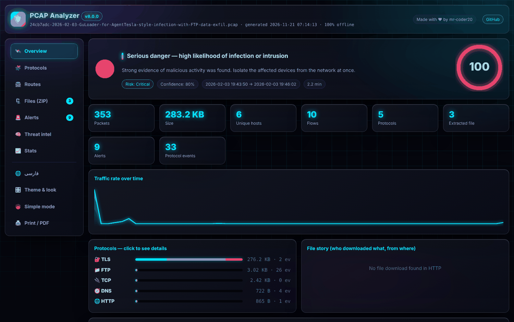 | 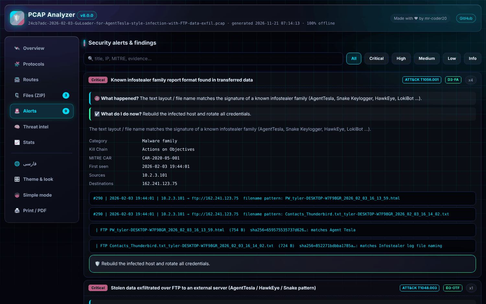 |
| **جزئیات پروتکل** (کلیک روی HTTP ← همه‌ی درخواست‌ها و فایل‌های دانلودشده) | **نمای مسیر** (هاست ↔ هاست) |
| 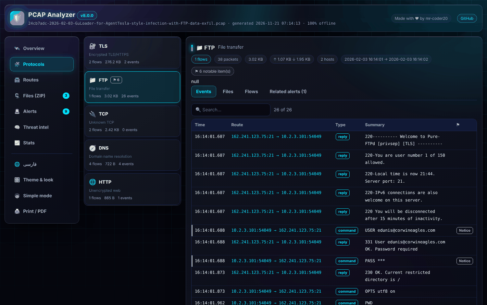 | 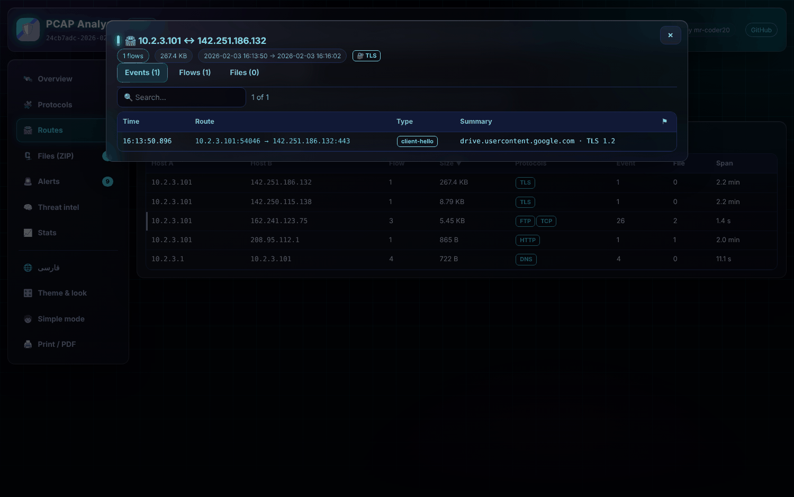 |
| **مرورگر ZIP** | **پیش‌نمایش فایل و هش‌ها** |
| 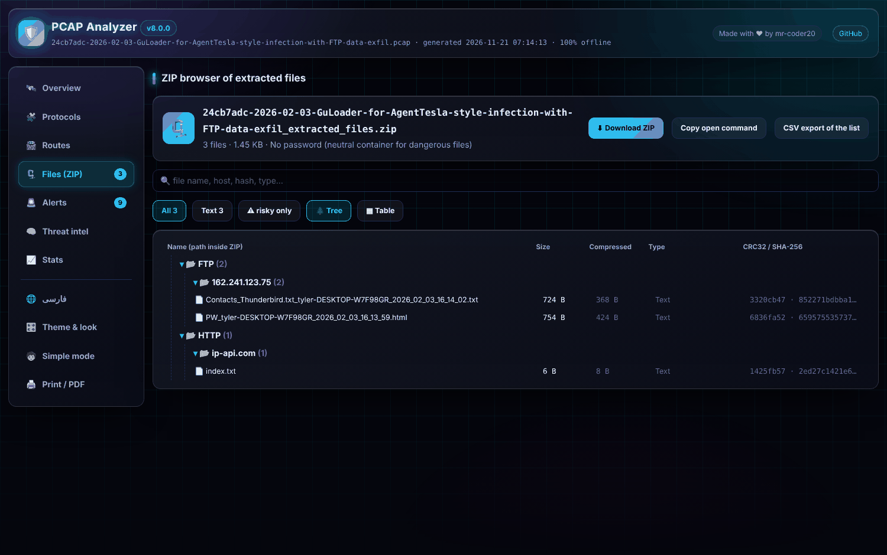 | 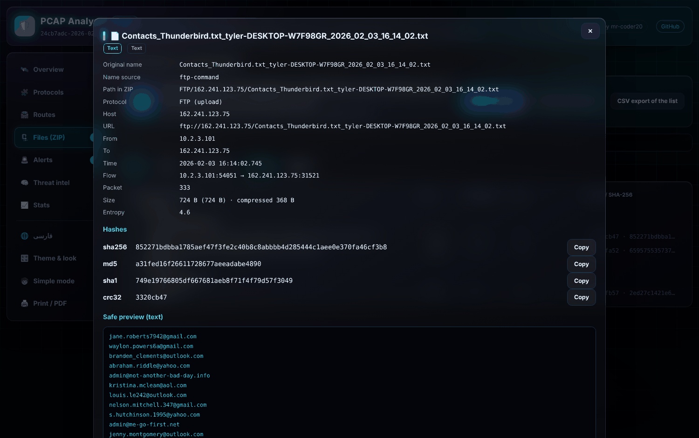 |

**۸ تم · ۴ متریال · تغییر زنده**

| Matrix | Synthwave | Crimson Ops |
|---|---|---|
| 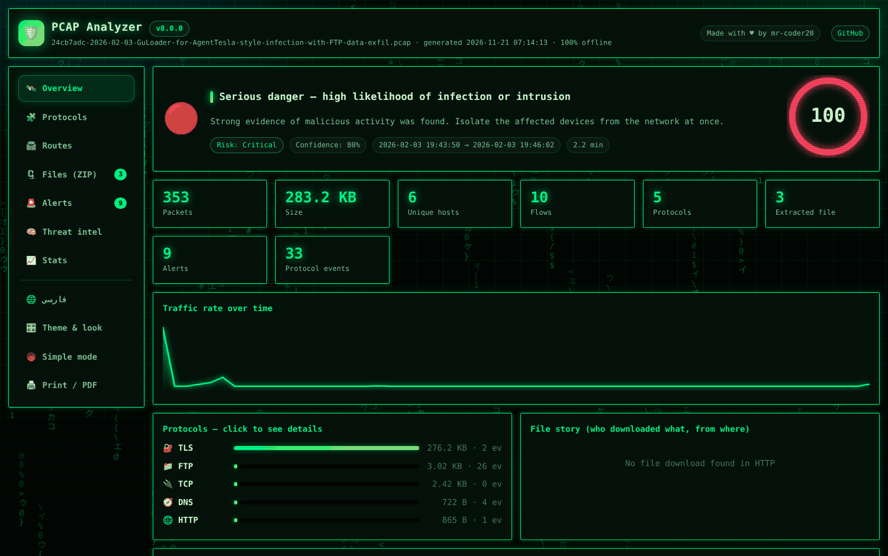 | 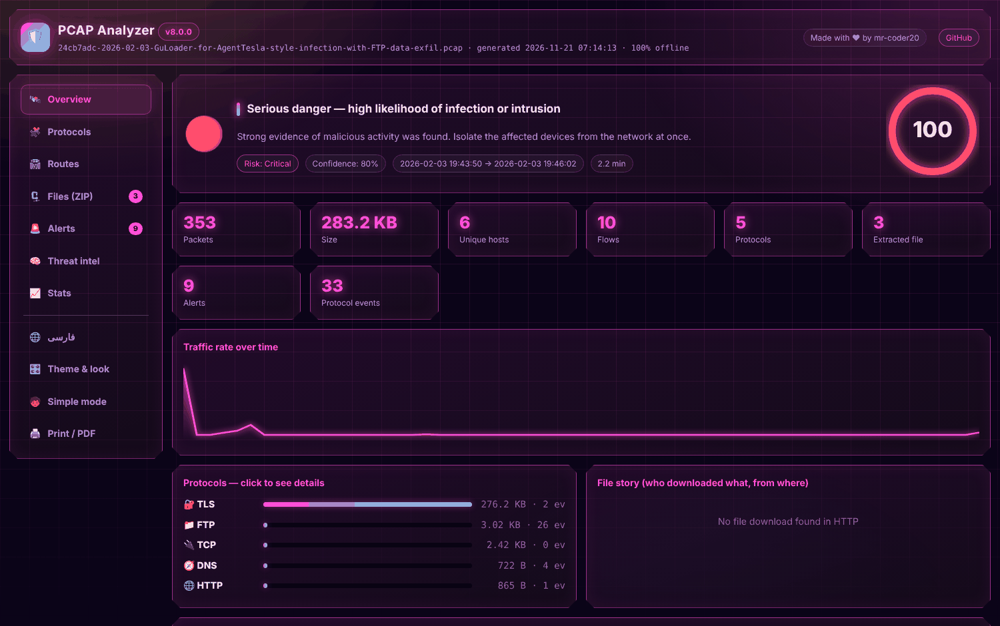 | 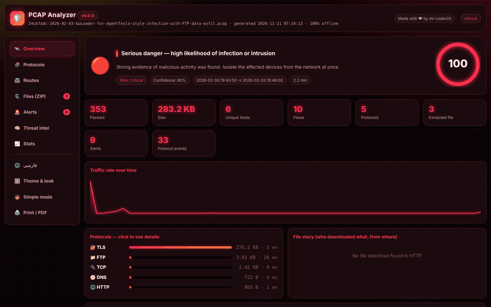 |

**حالت کامل فارسی / راست‌به‌چپ با یک کلیک**

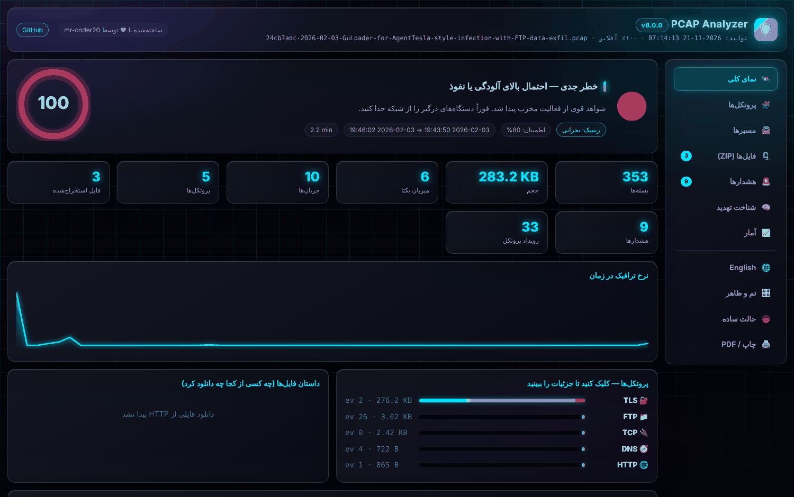

</div>

## ⚡ ویژگی‌های اصلی

- 🖱️ **روی هر پروتکل یا مسیر کلیک کنید** و ببینید دقیقاً چه شد. HTTP: همه‌ی درخواست/پاسخ‌ها، وضعیت، هاست، آدرس و **نام فایل‌های دانلودشده**. DNS · TLS (SNI/ALPN/JA3) · FTP · SMTP/POP3 و پیوست‌ها · SMB · DHCP · TFTP · ARP · ICMP.
- 📦 **استخراج دقیق فایل‌ها در ZIP** با ساختار `PROTO/host/نام-اصلی`، همراه `MANIFEST.json/.csv` و README. برای هر فایل: SHA-256، نوع واقعی، آنتروپی و هشدار پسوند نامتجانس / نوع پرخطر.
- 🧠 **موتور تهدید نسخه ۸** که درباره‌ی *محتوای واقعاً منتقل‌شده* استدلال می‌کند و سیگنال‌ها را به **زنجیره‌ی آلودگی** هر قربانی وصل می‌کند.
- 🎨 **ظاهر دلخواه**: ۸ تم، ۴ متریال (شیشه‌ای · توپر · هولوگرام · ترمینال)، شبکه / خطوط اسکن / درخشش / باران ماتریکس، تراکم، اندازه‌ی فونت، حالت ساده، LTR/RTL — زنده و ماندگار در مرورگر.
- 🌍 **دوزبانه**: پیش‌فرض انگلیسی، فارسی با یک کلیک (CLI، گزارش و رابط).
- 🚀 **سریع**: خواننده‌ی بومی mmap؛ scapy اختیاری است.
- 🛡️ **امن از پایه**: داده‌ی گزارش فقط با `textContent` نمایش داده می‌شود، رمزها ماسک، IOCها بی‌خطر، بدافزار در ZIP رمزدار یا قالب خنثی `.sample`.
- 🔎 **خروجی آماده‌ی دفاعی**: نگاشت MITRE ATT&CK و D3FEND، قوانین Suricata / YARA / Splunk / Elastic، فهرست IOC، تطبیق آفلاین (`--ioc-file`).

## 🧬 تشخیص تهدید

| قانون | چه چیزی را می‌گیرد | ATT&CK |
|---|---|---|
| `infection_chain` | برای هر قربانی: *مرحله‌بندی ابری ← استعلام IP عمومی ← استخراج داده* (سبک GuLoader + AgentTesla / Formbook / Snake) | T1204 |
| `stealer_ftp_exfil` | هاست داخلی به FTP بیرونی وارد شده و فایل آپلود می‌کند | T1048.003 |
| `stealer_smtp_exfil` | استخراج مستقیم با SMTP همراه پیوست / بدنه‌ی لاگ | T1048.003 |
| `stealer_credentials` | فهرست «Host / Username / Password / Application» در آپلود، نامه و POST | T1555 |
| `stealer_family_report` | قالب گزارش AgentTesla / Snake / HawkEye / LokiBot و نام‌گذاری `PW_ SC_ KL_ CO_` | T1056.001 |
| `address_book_harvest` | ده‌ها آدرس ایمیل در داده‌ی خروجی | T1114 |
| `ip_recon_lookup` | ip-api، ipify، ifconfig.me … | T1016 |
| `cloud_staging` | Drive، OneDrive، Dropbox، Mega، Discord CDN، GitHub raw، Pastebin، transfer.sh … | T1105 |
| `dyndns_domain` · `tor_traffic` · `irc_botnet` | DuckDNS / No-IP · Tor / .onion · کانال‌های IRC بات‌نت | T1568 · T1090.003 · T1071 |
| `exfil_webhook` · `malware_gate_post` · `suspicious_user_agent` | وب‌هوک Discord / Telegram / Slack · پنل `gate.php` · UAهای مشکوک | T1567 · T1041 · T1071.001 |
| `ransom_note` · `secret_leak` · `office_macro` · `disguised_executable` · `mail_malicious_attachment` · `smtp_spam_bot` | یادداشت باج‌افزار · کلید/توکن/کارت معتبر · ماکرو · `invoice.pdf.exe` · پیوست خطرناک · اسپم‌بات | T1486 · T1552 · T1566.001 · T1036.007 · T1071.003 |

## 🏆 اثبات واقعی

روی یک کپچر واقعی **GuLoader → AgentTesla → استخراج FTP** (۳۵۳ بسته) امتیاز از **۲۶ / متوسط** به **۱۰۰ / بحرانی** رسید، کل زنجیره توضیح داده شد و هر دو فایل داده‌ی سرقت‌شده بایت‌به‌بایت در ZIP تحویل شد.

## 🌐 زبان‌ها

- **CLI:** `--lang en|fa` یا `PCAP_LANG=fa`.
- **گزارش:** دکمه‌ی 🌐 زبان **و** جهت (LTR/RTL) را همان لحظه عوض می‌کند.
- **برنامه‌ی دسکتاپ:** تنظیمات ← *Language / زبان* (نیاز به راه‌اندازی مجدد).
- گزارش `classic` فقط فارسی است؛ گزارش پیش‌فرض `cyber` کاملاً دوزبانه است.

## 🚀 شروع سریع

<div dir="ltr">

```bash
git clone https://github.com/mr-coder20/pcap-analyzer.git && cd pcap-analyzer
pip install -r requirements.txt
pip install -r requirements-optional.txt     # pyzipper (AES), brotli, scapy

python pcap_analyzer.py                                  # GUI
python pcap_analyzer.py capture.pcap --cli               # CLI → report + ZIP
python pcap_analyzer.py capture.pcap --cli --theme matrix --material terminal -o out/
python pcap_analyzer.py --list-themes
python pcap_analyzer.py --doctor
```

</div>

سپس `out/<name>_pcap_report.html` را در هر مرورگری باز کنید.

## 🧾 گزینه‌های خط فرمان

| پرچم | معنی |
|---|---|
| `--lang en\|fa` | زبان (پیش‌فرض en) |
| `--theme ID` | neon-night، matrix، synthwave، crimson-ops، amber-terminal، ice-circuit، toxic-lime، paper-light |
| `--material M` | glass · solid · hologram · terminal |
| `--report-style S` | cyber · classic · both |
| `--formats LIST` | html,json,csv,rules,iocs |
| `--no-extract` | بدون استخراج / ZIP |
| `--extract-scope` | `all` یا `downloads` |
| `--zip-password PW` | رمز ZIP (پیش‌فرض `infected`؛ نیاز به pyzipper) |
| `--max-extract-mb` · `--max-stream-mb` · `--max-mem-mb` | سقف استخراج و حافظه |
| `--no-fast` | مسیر قدیمی scapy |

## 📁 پوشه‌ی خروجی

`<name>_pcap_report.html` · `.json` · `_findings.csv` · `_protocol_events.csv` · `_suricata.rules` · `_hunt.yar` · `_iocs_defanged.txt` · **`<name>_extracted_files.zip`** · `_extracted_manifest.json/.csv` · `reports_bundle.zip`

## ☣️ کار با ZIP — ایمنی

فایل‌های استخراج‌شده ممکن است **بدافزار واقعی** باشند.
- با **pyzipper** ZIP با AES-256 و رمز **`infected`** ساخته می‌شود.
- بدون آن، ZIP ساده است و فایل‌های پرخطر به‌صورت قالب خنثی `*.sample` (XOR) ذخیره می‌شوند (بازیابی: `--restore FILE.sample`).
- **فقط در ماشین مجازی ایزوله باز کنید.** هرگز فایل اجرایی استخراج‌شده را دابل‌کلیک نکنید.

## 🏗️ معماری

| ماژول | نقش |
|---|---|
| `pcap_fastio.py` | خواننده‌ی mmap و پارسرهای DNS/DHCP/SNMP/SMB2/TLS |
| `pcap_protocols.py` | هاب پروتکل: رویدادها، جریان‌ها، استخراج HTTP/FTP/ایمیل/TFTP |
| `pcap_threats.py` | موتور تهدید ۸: آشکارسازها، جدول‌های intel، زنجیره‌ی آلودگی |
| `pcap_extract.py` | تشخیص نوع، پیش‌نمایش، `FileStore` |
| `pcap_report_cyber.py` | گزارش HTML سایبری دوزبانه |
| `pcap_i18n.py` · `pcap_rules_en.py` | لایه‌ی ترجمه |
| `pcap_themes.py` | تم‌ها و متریال‌ها |
| `pcap_analyzer.py` | موتور، CLI، رابط Tk |

## 🧪 آزمون‌ها

<div dir="ltr">

```bash
pip install pytest
pytest -q
```

</div>

## ⚠️ محدودیت‌ها (صادقانه)

- ترافیک رمزشده (TLS / SSH / QUIC) بدون کلید قابل استخراج نیست؛ فقط فراداده (SNI، ALPN، JA3) نمایش داده می‌شود.
- کپچرهای ناقص یا نامرتب ممکن است فایل ناقص بدهند (علامت‌گذاری می‌شود).
- رابط Tk (و هوک ترجمه) و مسیر ZIP با AES کمتر از CLI/گزارش آزمایش شده‌اند؛ مشکلات را گزارش کنید.

## ❓ پرسش‌های متداول

**آیا pcap جایی آپلود می‌شود؟** خیر؛ کاملاً آفلاین.
**به Wireshark یا scapy نیاز دارم؟** خیر.
**HTTPS را رمزگشایی می‌کند؟** خیر؛ فقط SNI/ALPN/JA3.

## 🤝 مشارکت و ⭐

Issue و PR خوش‌آمد است. اگر به کارتان آمد، **به مخزن ستاره بدهید** → [https://github.com/mr-coder20/pcap-analyzer](https://github.com/mr-coder20/pcap-analyzer)

مجوز MIT · ساخته‌ی [mr-coder20](https://github.com/mr-coder20)

</div>
