<div align="center">

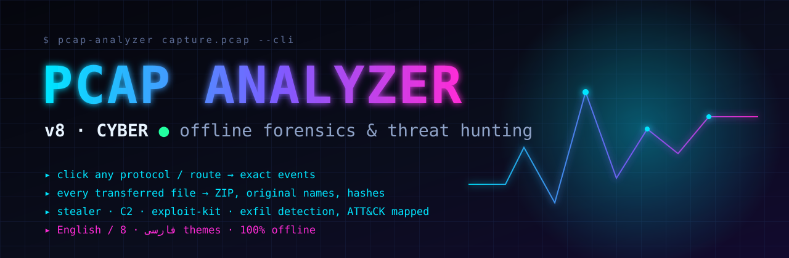

<a href="https://github.com/mr-coder20/pcap-analyzer/releases/latest"></a>
<a href="https://github.com/mr-coder20/pcap-analyzer/releases"></a>
<a href="https://github.com/mr-coder20/pcap-analyzer/stargazers"></a>


### 🛰️ Drop in a PCAP → get the whole story, the verdict, and every file that crossed the wire.

**Offline forensics & threat hunting · dark-cyber reports · click-any-protocol drill-down · exact file extraction to ZIP**

🇬🇧 **English** · 🇮🇷 [فارسی](README.fa.md)

<a href="https://github.com/mr-coder20/pcap-analyzer/releases/latest"></a>

</div>

---

## 📡 Get it (no Python needed)

| Platform | Download |
|---|---|
| 🪟 Windows x64 | [`PCAP-Analyzer-windows-x64.exe`](https://github.com/mr-coder20/pcap-analyzer/releases/latest/download/PCAP-Analyzer-windows-x64.exe) |
| 🍎 macOS Apple Silicon | [`PCAP-Analyzer-macos-arm64.zip`](https://github.com/mr-coder20/pcap-analyzer/releases/latest/download/PCAP-Analyzer-macos-arm64.zip) |
| 🍎 macOS Intel | [`PCAP-Analyzer-macos-x64.zip`](https://github.com/mr-coder20/pcap-analyzer/releases/latest/download/PCAP-Analyzer-macos-x64.zip) |
| 🐧 Linux x64 | [`PCAP-Analyzer-linux-x64.tar.gz`](https://github.com/mr-coder20/pcap-analyzer/releases/latest/download/PCAP-Analyzer-linux-x64.tar.gz) |

➡️ **All releases, checksums & changelog:** [https://github.com/mr-coder20/pcap-analyzer/releases/latest](https://github.com/mr-coder20/pcap-analyzer/releases/latest)
Or run from source: `python pcap_analyzer.py capture.pcap --cli` (Python 3.9+, standard library only).

> Binaries are not code-signed: Windows SmartScreen / macOS Gatekeeper may warn. Verify with the `SHA256SUMS` file in the release.

## 📖 Contents
[Why](#-why-it-exists) · [Screenshots](#-see-it) · [Features](#-features) · [Threat detection](#-threat-detection) · [Real-world proof](#-real-world-proof) · [Languages](#-english--فارسی) · [Quick start](#-quick-start) · [CLI](#-cli-reference) · [Output](#-output) · [ZIP safety](#-working-with-the-zip--safety) · [Architecture](#-architecture) · [Tests](#-tests) · [Limits](#-honest-limitations) · [FAQ](#-faq)

## 🎯 Why it exists

Wireshark shows packets. **PCAP Analyzer tells you what happened.** It reassembles streams, pulls out every transferred file with its real name, correlates signals per victim host into an **infection chain**, scores the capture, and ships a single self-contained cyber report you can hand to anyone. Everything runs **100 % offline** — your captures never leave the machine.

## 🖼️ See it

<div align="center">

| Overview | Findings & infection chain |
|---|---|
| 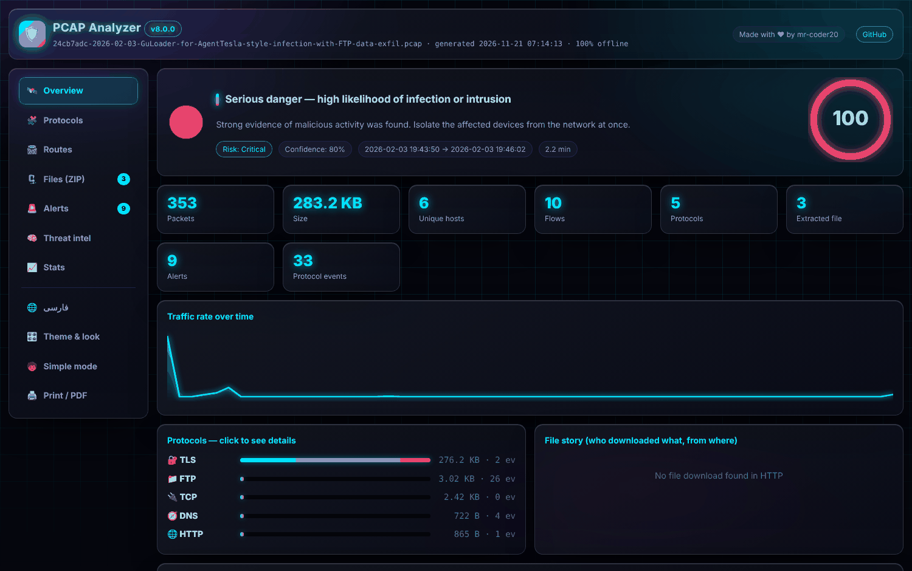 | 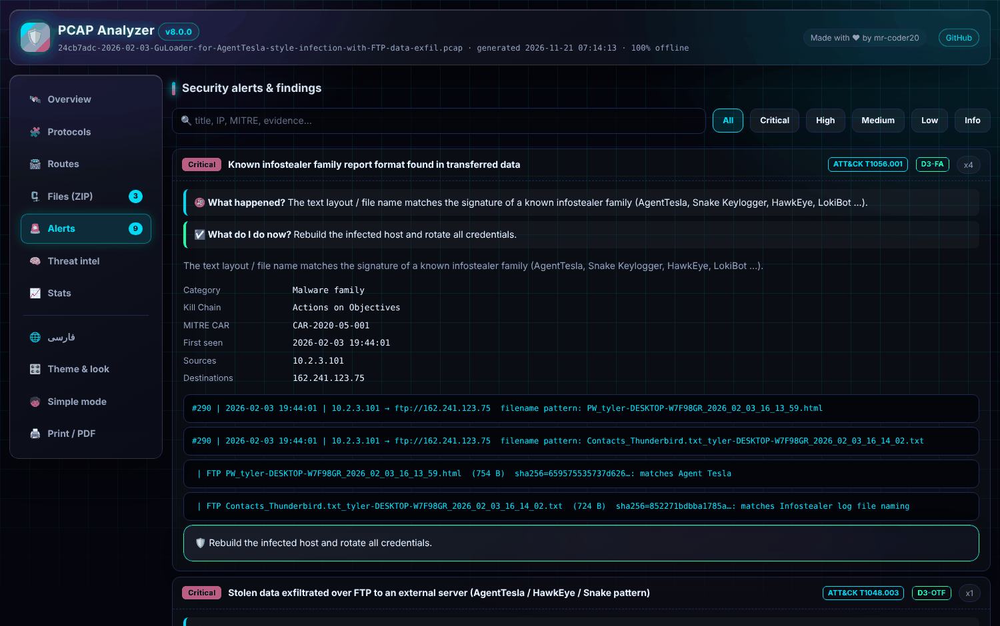 |
| **Protocol drill-down** (click HTTP → every request & downloaded file) | **Route view** (host ↔ host) |
| 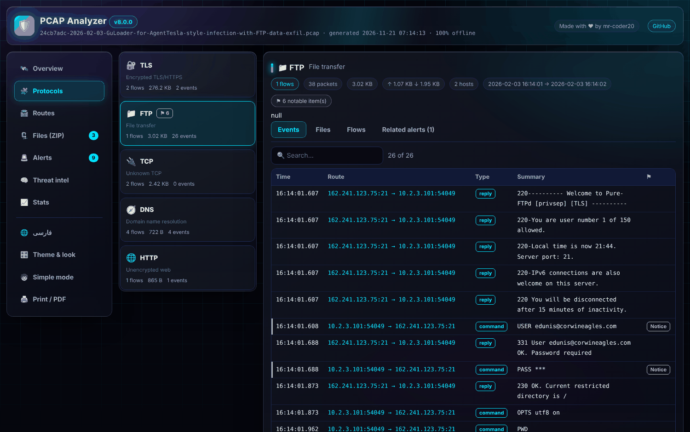 | 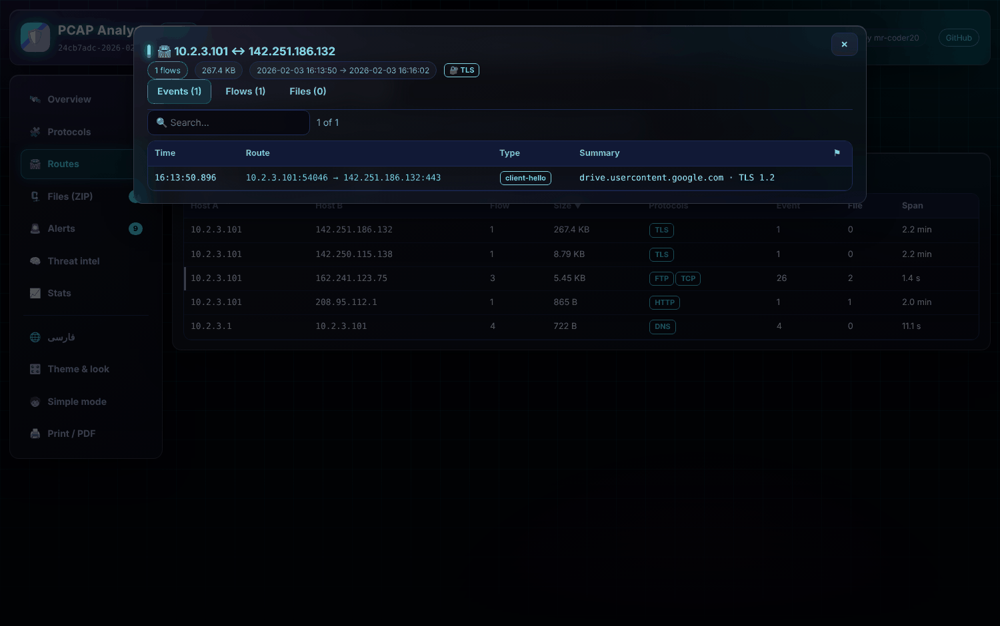 |
| **ZIP explorer** | **File preview + hashes** |
| 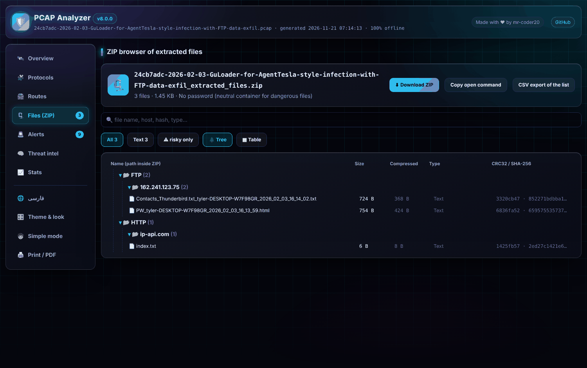 | 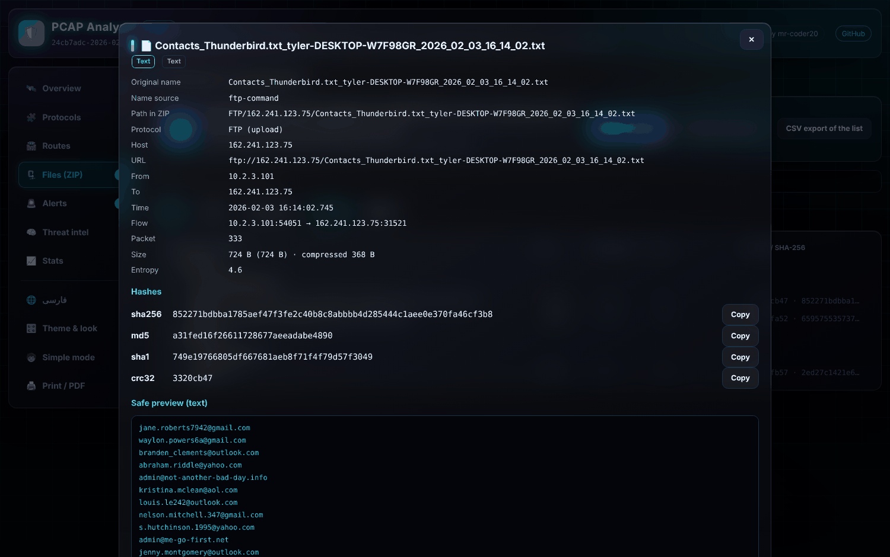 |

**8 themes · 4 materials · live switching**

| Matrix | Synthwave | Crimson Ops |
|---|---|---|
| 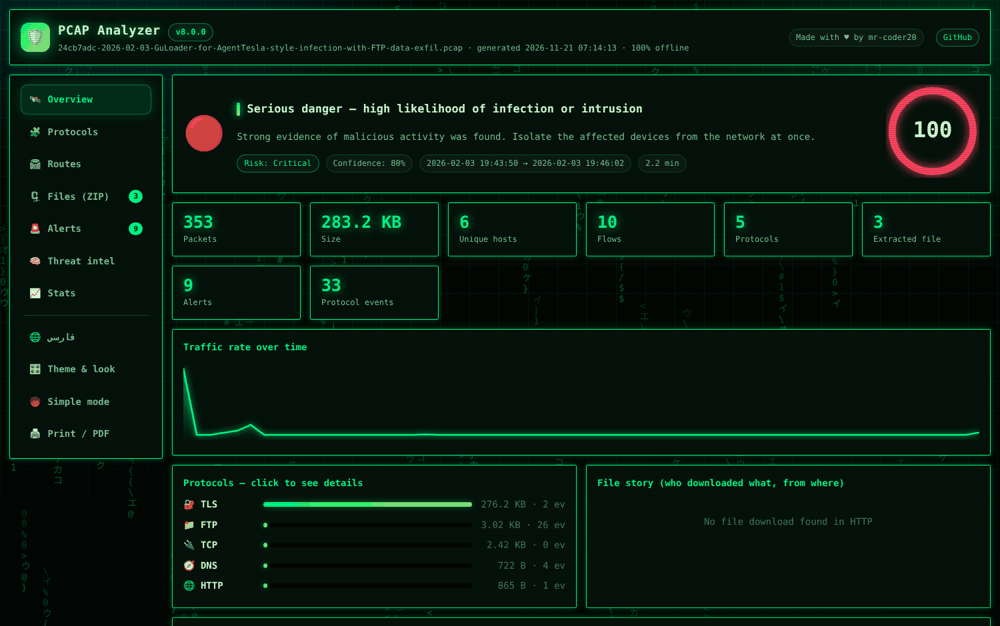 | 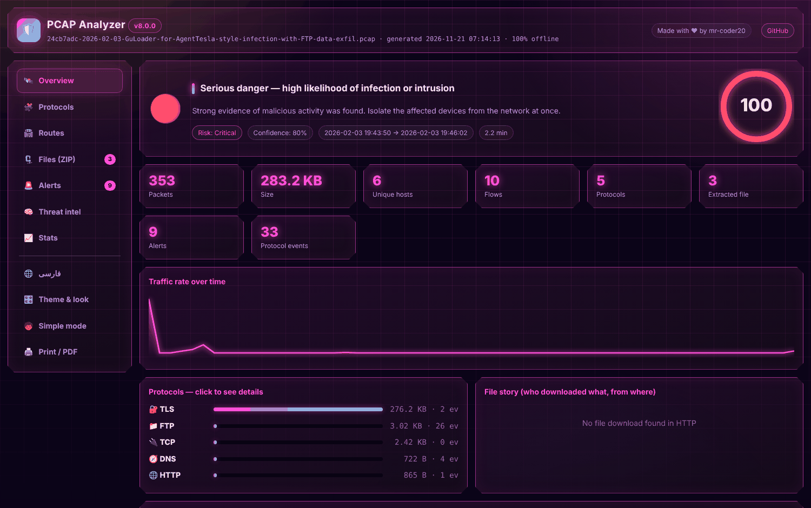 | 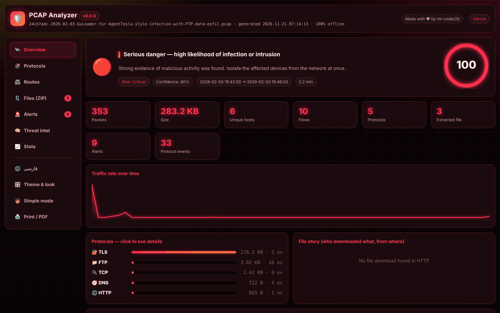 |

**Full Persian / RTL mode with one click**

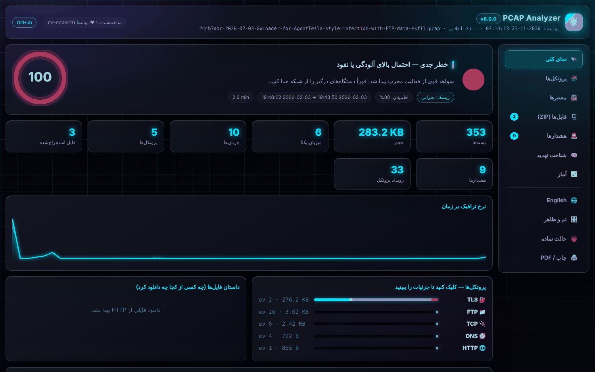

</div>

## ⚡ Features

- 🖱️ **Click any protocol or route** → exactly what happened. HTTP: every request/response, status, host, URI and the **names of downloaded files**. DNS queries/answers/NXDOMAIN · TLS SNI/ALPN/JA3 · FTP commands & transfers · SMTP/POP3 mail & attachments · SMB · DHCP · TFTP · ARP · ICMP.
- 📦 **Exact file extraction → ZIP.** Rebuilt from streams (Content-Length, chunked, until-close; gzip/deflate/brotli; multipart & PUT uploads; FTP data channels; mail attachments; TFTP) and stored as `PROTO/host/original-name` with `MANIFEST.json/.csv` and a README. Each file: SHA-256, magic-byte type, entropy, extension-mismatch / risky-type flags.
- 🧠 **Threat engine v8** that reasons about *what was actually transferred* and links signals into a per-victim **infection chain** (see below).
- 🎨 **Your look**: 8 themes, 4 materials (glass · solid · hologram · terminal), grid / scanlines / glow / matrix rain, density, font size, simple mode, LTR/RTL — switch live, remembered in the browser.
- 🌍 **Bilingual**: English by default, Persian with one click (CLI, report and GUI).
- 🚀 **Fast**: native mmap pcap/pcapng reader and parsers. Scapy is optional.
- 🛡️ **Safe by design**: all report data rendered via `textContent` (hostile captures can't inject HTML), passwords masked, IOCs defanged, malware stored in an encrypted ZIP or neutral `.sample` containers.
- 🔎 **Ready-to-use detection content**: MITRE ATT&CK + D3FEND mapping, Suricata / YARA / Splunk / Elastic rules, defanged IOC list, offline IOC matching (`--ioc-file`).
- 🧰 Kept from v7: DGA / DNS tunneling, beaconing, scans, C2 over public services, miners, PsExec/SMB, Kerberos, web attacks.

## 🧬 Threat detection

v8 reassembles streams and extracts files *first*, then reasons about the content:

| Rule | What it catches | ATT&CK |
|---|---|---|
| `infection_chain` | Per victim: *cloud staging → public-IP lookup → exfiltration* (GuLoader + AgentTesla / Formbook / Snake style) | T1204 |
| `stealer_ftp_exfil` | Internal host logs in to an external FTP server and uploads files (credentials masked) | T1048.003 |
| `stealer_smtp_exfil` | Direct SMTP exfiltration with attachments / log bodies | T1048.003 |
| `stealer_credentials` | "Host / Username / Password / Application" dumps in uploads, mail bodies, POSTs | T1555 |
| `stealer_family_report` | AgentTesla / Snake / HawkEye / LokiBot layouts and `PW_ SC_ KL_ CO_` file names | T1056.001 |
| `address_book_harvest` | Dozens of e-mail addresses in outbound data | T1114 |
| `ip_recon_lookup` | ip-api, ipify, ifconfig.me … (incl. `fields=hosting` sandbox checks) | T1016 |
| `cloud_staging` | Drive, OneDrive, Dropbox, Mega, Discord CDN, GitHub raw, Pastebin, transfer.sh … | T1105 |
| `dyndns_domain` · `tor_traffic` · `irc_botnet` | DuckDNS / No-IP / ddns.net · .onion / Tor · IRC bot channels | T1568 · T1090.003 · T1071 |
| `exfil_webhook` · `malware_gate_post` · `suspicious_user_agent` | Discord / Telegram / Slack hooks · `gate.php` / `fre.php` panels · fake-IE7 / empty / scripted UAs | T1567 · T1041 · T1071.001 |
| `ransom_note` · `secret_leak` · `office_macro` · `disguised_executable` · `mail_malicious_attachment` · `smtp_spam_bot` | Ransom notes · private keys / API tokens / Luhn-valid cards · VBA macros · `invoice.pdf.exe` · dangerous attachments · spam bots | T1486 · T1552 · T1566.001 · T1036.007 · T1071.003 |

## 🏆 Real-world proof

On a real **GuLoader → AgentTesla → FTP exfiltration** capture (353 packets) the risk score went from **26 / medium → 100 / critical**, the full chain was explained, and both stolen-data files were delivered, byte-exact, in the ZIP.

## 🌐 English / فارسی

English is the default everywhere; Persian is one switch away.
- **CLI:** `--lang en|fa` (or `PCAP_LANG=fa`) — `--help` and messages are translated.
- **Report:** the 🌐 button flips language **and** direction (LTR/RTL) instantly, including rule texts, evidence and plain-language explanations.
- **Desktop app:** Settings → *Language / زبان* (saved in `~/.pcap_analyzer/config.json`; restart to apply).
- The legacy `classic` report is Persian-only; the default `cyber` report is fully bilingual.

## 🚀 Quick start

```bash
git clone https://github.com/mr-coder20/pcap-analyzer.git && cd pcap-analyzer
pip install -r requirements.txt              # pillow (GUI only)
pip install -r requirements-optional.txt     # pyzipper (AES ZIP), brotli, scapy fallback

python pcap_analyzer.py                                  # GUI
python pcap_analyzer.py capture.pcap --cli               # CLI → report + ZIP
python pcap_analyzer.py capture.pcap --cli --theme matrix --material terminal -o out/
python pcap_analyzer.py --list-themes
python pcap_analyzer.py --doctor
```

Then open `out/<name>_pcap_report.html` in any browser.

## 🧾 CLI reference

| Flag | Meaning |
|---|---|
| `--lang en\|fa` | interface language (default `en`) |
| `--theme ID` | neon-night (default), matrix, synthwave, crimson-ops, amber-terminal, ice-circuit, toxic-lime, paper-light |
| `--material M` | glass · solid · hologram · terminal |
| `--report-style S` | cyber · classic · both |
| `--formats LIST` | comma list of html,json,csv,rules,iocs |
| `--no-extract` | no file extraction / no ZIP |
| `--extract-scope` | `all` or `downloads` (skip web HTML/JS/CSS/JSON) |
| `--zip-password PW` | ZIP password (default `infected`; needs pyzipper) |
| `--max-extract-mb N` · `--max-stream-mb N` · `--max-mem-mb N` | extraction / reassembly caps |
| `--no-fast` | force the legacy scapy path |
| `--sample-mode` · `--ioc-file` · `--no-defang` · `--unmask` · `--max-packets` · `--no-bundle` | as in v7 |

## 📁 Output

`<name>_pcap_report.html` · `.json` · `_findings.csv` · `_protocol_events.csv` · `_suricata.rules` · `_hunt.yar` · `_iocs_defanged.txt` · **`<name>_extracted_files.zip`** · `_extracted_manifest.json/.csv` · `reports_bundle.zip`

## ☣️ Working with the ZIP — safety

Extracted files can be **real malware**.
- With **pyzipper** the ZIP is AES-256 encrypted, password **`infected`**.
- Without it the ZIP is plain and risky files (executables, scripts…) are stored as neutral `*.sample` XOR containers (restore with `--restore FILE.sample`).
- **Open only inside an isolated VM.** Never double-click extracted executables.

## 🏗️ Architecture

| Module | Role |
|---|---|
| `pcap_fastio.py` | mmap pcap/pcapng reader, link/IP/TCP/UDP decode, DNS/DHCP/SNMP/SMB2/TLS parsers |
| `pcap_protocols.py` | protocol hub: events, flows, HTTP/FTP/mail/TFTP extraction |
| `pcap_threats.py` | threat engine v8: detectors, intel tables, infection-chain correlation |
| `pcap_extract.py` | type sniffing, previews, `FileStore` (ZIP, manifest, safe modes) |
| `pcap_report_cyber.py` | single-file bilingual cyber HTML report |
| `pcap_i18n.py` · `pcap_rules_en.py` | EN/FA translation layer |
| `pcap_themes.py` | themes/materials shared by report and GUI |
| `pcap_analyzer.py` | engine, CLI, Tk GUI |

## 🧪 Tests

```bash
pip install pytest
pytest -q
```
`tests/make_native_pcap.py` builds harmless captures (fake PE header, no real malware) without scapy — including a synthetic stealer FTP-exfil scenario.

## ⚠️ Honest limitations

- Encrypted traffic (TLS / SSH / QUIC) can't be extracted without keys; only metadata (SNI, ALPN, JA3) is shown.
- Truncated or out-of-order captures may yield partial files (flagged); extraction is memory/size-capped.
- The Tk GUI (incl. the translation hook) and the AES-ZIP path have been less exercised than the CLI/report; please file issues.

## ❓ FAQ

**Does it upload my pcap anywhere?** No. Fully offline; the report is one local HTML file.
**Do I need Wireshark / scapy?** No. The core engine is standard-library only.
**Is the ZIP safe to open?** Only in a VM — it may contain live malware (see above).
**Can it decrypt HTTPS?** No. It reports SNI/ALPN/JA3 for encrypted flows.

## 🤝 Contributing & ⭐

Issues and PRs welcome. If this saved you time, **star the repo** so others can find it → [https://github.com/mr-coder20/pcap-analyzer](https://github.com/mr-coder20/pcap-analyzer)

MIT License · by [mr-coder20](https://github.com/mr-coder20)
